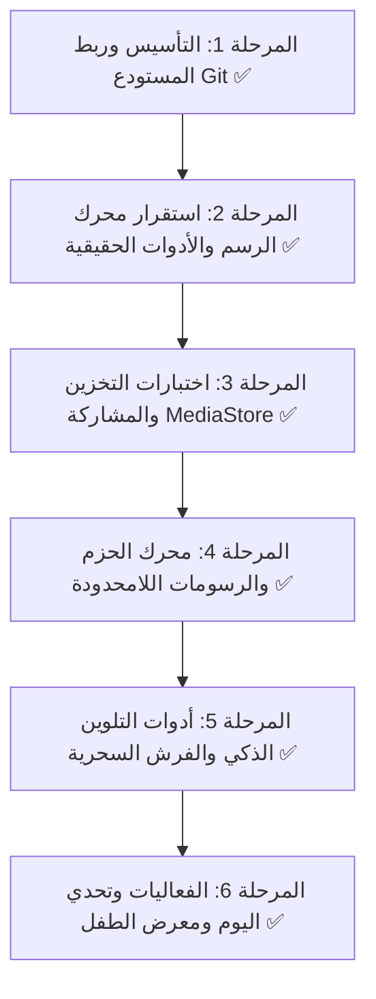

# 🗺️ خطة عمل وخارطة طريق تطوير تطبيق Drawing for Kids

مشروع: **Drawing for Kids**  
المستودع: [https://github.com/Sa4aC3n/Drawing](https://github.com/Sa4aC3n/Drawing)  
الفرع الأساسي: `main`  
الهدف: تحويل التطبيق إلى منصة رسم وتلوين عالمية غير محدودة للأطفال، وفق معايير برمجية صارمة واختبارات تحقق لكل مرحلة.

---

## 📌 المنهجية المتبعة
1. كل مرحلة لها أهداف واضحة ومخرجات محددة.
2. لا يتم الانتقال من مرحلة إلى المرحلة التالية إلا بعد تشغيل الاختبارات والتأكد من عمل كل ميزة فعلياً.
3. كل مرحلة يتم رفع تعديلاتها وتوثيقها بـ Commit صريح ومفصل على فرع `main`.

---

---

## 🚩 تفاصيل المراحل بالترتيب

###  المرحلة 1: التأسيس وهيكلة المشروع وربط المستودع (Git & Architecture) ✅
- [x] تحويل الكود بالكامل من Java/Eclipse إلى Kotlin/Android Studio Gradle الحديث.
- [x] ترقية `targetSdk` إلى 35 و `minSdk` إلى 21.
- [x] ربط معرفات AdMob الحقيقية وتكوين `AndroidManifest.xml`.
- [x] إنشاء ملف `.gitignore` متكامل لاستبعاد مجلدات `.gradle`, `build/`, `*.iml`, `.idea/`.
- [x] تهيئة Git وربط الـ Remote مع `https://github.com/Sa4aC3n/Drawing`.
- [x] رفع الكود الأساسي على فرع `main`.
- **معيار التحقق:** ظهور المستودع كاملاً على GitHub مع هيكل ملفات نظيف وبناء Gradle متوافق.

---

###  المرحلة 2: استقرار محرك الرسم والأدوات واختبارات المسار (Core Canvas Engine) ✅
- [x] معالجة خلل الممحاة القديم وتحويلها للرسم الأبيض النقي دون تشوهات سوداء.
- [x] إضافة نظام التراجع والإعادة (Undo / Redo) في `PaintView`.
- [x] تصدير الصورة بدقة عالية عبر `exportBitmap()` بدلاً من `getDrawingCache` الملغى.
- [x] إضافة اختبارات Unit Tests لمنطق الـ Stroke History والـ Undo Stack (`DrawingHistoryTrackerTest.kt`).
- [x] دعم مسارات بيزيه الناعمة (`path.quadTo`) وحماية الحركات.
- **معيار التحقق:** تشغيل اختبارات الوحدة بنجاح، وتجربة رسم وتراجع سلس دون أي تسريب ذاكرة أو بطء.

---

### المرحلة 3: التخزين الآمن والمشاركة واختبارات الوسائط (Storage & MediaStore) ✅
- [x] دعم حفظ الصور على أندرويد 10+ عبر `MediaStore API` مع مجلد `Pictures/DrawingForKids`.
- [x] دعم الحفظ المتوافق مع أندرويد 9 فما دون مع فحص الأذونات ومجلد التخزين الداخلي.
- [x] مشاركة الصور عبر `FileProvider` و `content:// URI`.
- [x] اختبار سلامة الملف: فحص حجم الصورة والتأكد من أنها أكبر من 0 بايت قبل إشعار المستخدم.
- [x] إنشاء مدير تخزين مخصص `DrawingStorageManager` واختباره بـ `DrawingStorageManagerTest.kt`.
- **معيار التحقق:** التحقق من وجود الصورة المحفوظة في ألبوم الصور بالنظام ومشاركتها عبر التطبيقات الأخرى بنجاح.

---

### المرحلة 4: بنية المحتوى اللامحدود والحزم الديناميكية (Infinite Packs Engine) ✅
- [x] فصل بيانات الرسومات عن الكود المصدري عبر محرك `DrawingLessonRepository`.
- [x] تصنيف الدروس لمجموعات ذكية (`CategoryGroup`: حيوانات، مركبات، شخصيات، طبيعة).
- [x] إضافة شريط التصنيفات السريع (`ChipGroup`) في الشاشة الرئيسية لفلترة الدروس بلمسة واحدة.
- [x] إضافة اختبارات الوحدة `CategoryGroupTest.kt`.
- **معيار التحقق:** تصفح الفئات وتصفيتها فورياً دون إعادة بناء القائمة أو استهلاك الذاكرة.

---

### المرحلة 5: أدوات التلوين الذكي والفرش السحرية (Magic Shaders & Brushes) ✅
- [x] وضع القلم الكلاسيكي (Classic Pencil).
- [x] وضع الممحاة النقية (Clean Eraser).
- [x] وضع **فرشاة النيون المتوهجة (Neon Glow)** مع ظلال `BlurMaskFilter` ناعمة.
- [x] وضع **قوس قزح السحري (Rainbow Magic)** المتغير لونياً مع حركة يد الطفل.
- [x] نافذة اختيار الفرشاة التفاعلية عبر الضغط أو الضغط المطول على أيقونة القلم.
- [x] إضافة اختبارات الوحدة `BrushModeTest.kt`.
- **معيار التحقق:** رسم خطوط نيون وقوس قزح وتصديرها بصورة صافية وحفظها في المعرض.

---

### المرحلة 6: الفعاليات وتحدي اليوم ومعرض الطفل (Gamification & Gallery) ✅
- [x] ميزة **"تحدي اليوم" (Daily Challenge)** عبر `DailyChallengeManager`: رسمة مقترحة يومياً تلقائياً مع بطاقة تفاعلية أعلى الشاشة.
- [x] ميزة **"معرض لوحاتي" (My Gallery)** عبر `MyGalleryActivity`: استعراض كافة أعمال الطفل الفنية المحفوظة داخل التطبيق في شبكة بطاقات أنيقة.
- [x] إمكانية مشاركة أي لوحة سابقة أو حذفها بأمان من داخل المعرض الداخلي.
- [x] إضافة اختبارات `DailyChallengeManagerTest.kt`.
- **معيار التحقق:** فتح المعرض الداخلي واستعراض الصور المحفوظة والتحقق من التحدي اليومي.
