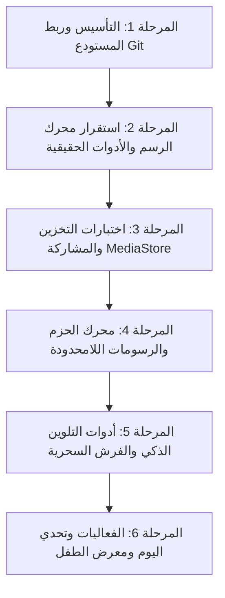

# 🗺️ خطة عمل وخارطة طريق تطوير تطبيق Drawing for Kids

مشروع: **Drawing for Kids**  
المستودع: [https://github.com/Sa4aC3n/Drawing](https://github.com/Sa4aC3n/Drawing)  
الفرع الأساسي: `main`  
الهدف: تحويل التطبيق إلى منصة رسم وتلوين عالمية غير محدودة للأطفال، وفق معايير برمجية صارمة واختبارات تحقق لكل مرحلة.

---

## 📌 المنهجية المتبعة
1. كل مرحلة لها أهداف واضحة ومخرجات محددة.
2. لا يتم الانتقال من مرحلة إلى المرحلة التالية إلا بعد تشغيل الاختبارات والتأكد من عمل كل ميزة فعلياً.
3. كل مرحلة يتم رفع تعديلاتها وتوثيقها بـ Commit صريح ومفصل على فرع `main`.

---

---

## 🚩 تفاصيل المراحل بالترتيب

###  المرحلة 1: التأسيس وهيكلة المشروع وربط المستودع (Git & Architecture)
- [x] تحويل الكود بالكامل من Java/Eclipse إلى Kotlin/Android Studio Gradle الحديث.
- [x] ترقية `targetSdk` إلى 35 و `minSdk` إلى 21.
- [x] ربط معرفات AdMob الحقيقية وتكوين `AndroidManifest.xml`.
- [x] إنشاء ملف `.gitignore` متكامل لاستبعاد مجلدات `.gradle`, `build/`, `*.iml`, `.idea/`.
- [ ] تهيئة Git وربط الـ Remote مع `https://github.com/Sa4aC3n/Drawing`.
- [ ] رفع الكود الأساسي على فرع `main`.
- **معيار التحقق:** ظهور المستودع كاملاً على GitHub مع هيكل ملفات نظيف وبناء Gradle متوافق.

---

###  المرحلة 2: استقرار محرك الرسم والأدوات واختبارات المسار (Core Canvas Engine)
- [x] معالجة خلل الممحاة القديم وتحويلها للرسم الأبيض النقي دون تشوهات سوداء.
- [x] إضافة نظام التراجع والإعادة (Undo / Redo) في `PaintView`.
- [x] تصدير الصورة بدقة عالية عبر `exportBitmap()` بدلاً من `getDrawingCache` الملغى.
- [ ] إضافة اختبارات Unit Tests لمنطق الـ Stroke History والـ Undo Stack.
- [ ] دعم رفض اللمسات العشوائية براحة اليد (Palm Rejection) وتنعيم المسارات.
- **معيار التحقق:** تشغيل اختبارات الوحدة بنجاح، وتجربة رسم 50 خطاً مع التراجع عنها خطوة بخطوة وإعادة رسمها دون أي تسريب ذاكرة أو بطء.

---

### المرحلة 3: التخزين الآمن والمشاركة واختبارات الوسائط (Storage & MediaStore)
- [x] دعم حفظ الصور على أندرويد 10+ عبر `MediaStore API` مع مجلد `Pictures/DrawingForKids`.
- [x] دعم الحفظ المتوافق مع أندرويد 9 فما دون مع فحص الأذونات ومجلد التخزين الداخلي.
- [x] مشاركة الصور عبر `FileProvider` و `content:// URI`.
- [ ] اختبار سلامة الملف: التأكد من أن الصورة الناتجة بصيغة JPEG غير تالفة، وحجمها أكبر من 0 بايت قبل إشعار المستخدم.
- [ ] دعم إضافة إطار مرح (Border / Frame) اختياري حول الرسمة عند التصدير.
- **معيار التحقق:** التحقق من وجود الصورة المحفوظة في ألبوم الصور بالنظام وفتحها ومشاركتها عبر تطبيق آخر.

---

### المرحلة 4: بنية المحتوى اللامحدود والحزم الديناميكية (Infinite Packs Engine)
- [ ] فصل بيانات الرسومات عن الكود المصدري عبر محرك JSON منظم (`lessons.json`).
- [ ] إضافة 5 حزم رسومات جديدة كلياً:
  1. حزمة عالم الديناصورات (T-Rex، ترايسيراتوبس، برونتوسورس).
  2. حزمة رحلة إلى الفضاء (صاروخ، رائد فضاء، كوكب، صحن طائر).
  3. حزمة أعماق البحار (حوت، دولفين، أخطبوط، قنديل البحر).
  4. حزمة المهن والمستقبل (طبيب، إطفائي، طيار، مهندس).
  5. حزمة الطبيعة اللطيفة (شمس باسمة، قوس قزح، شجرة، جبل).
- [ ] نظام تصفية الفئات (Tabs / Chips) للتبديل بين الفئات بسهولة في الشاشة الرئيسية.
- **معيار التحقق:** تحميل وتصفح الفئات الجديدة بسلاسة وعرض خطوات الرسم لكل فئة دون استهلاك مفرط للذاكرة.

---

### المرحلة 5: أدوات التلوين الذكي والفرش السحرية (Magic Shaders & Smart Fill)
- [ ] تنفيذ خوارزمية **دلو الألوان الذكي (Flood Fill / Tap-to-Fill)** لتلوين المساحات المغلقة بلمسة واحدة.
- [ ] إضافة فرش سحرية جديدة:
  - **قلم النيون المتوهج (Neon Glow)**.
  - **فرشاة قوس قزح (Rainbow Multi-color)**.
  - **فرشاة النجوم المتلألئة (Sparkle / Stamp Brush)**.
- **معيار التحقق:** تلوين فراغ مغلق دون تسرب اللون للخارج، ورسم خطوط بالفرش الجديدة مع معدل إطارات 60fps ثابت.

---

### المرحلة 6: الفعاليات وتحدي اليوم ومعرض الطفل (Gamification & Gallery)
- [ ] ميزة **"تحدي اليوم" (Daily Drawing Challenge)**: رسمة مقترحة يومياً تكافئ الطفل بالنجوم عند إكمالها.
- [ ] ميزة **"معرض أعمالي" (My Gallery Screen)**: استعراض جميع الرسومات التي حفظها الطفل داخل التطبيق، مع إمكانية إعادة فتحها أو تلوينها أو حذفها.
- [ ] مؤثرات صوتية وتشجيعية مبهجة للأطفال قابلة للتشغيل/الكتم في الإعدادات.
- **معيار التحقق:** حفظ ومراجعة الرسمة في معرض التطبيق وتشغيل الأصوات التشجيعية بنجاح.
